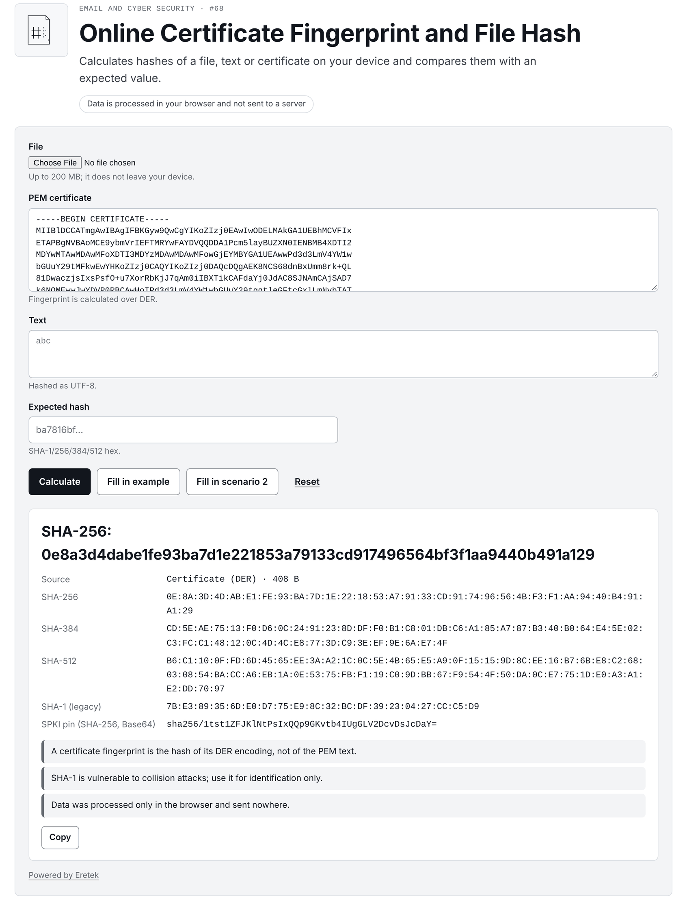

# Certificate Fingerprint and File Hash

Calculate a certificate's SHA-256/SHA-1 fingerprint and SPKI pin, or the SHA-256/384/512 hash of a file or text in your browser; compare with an expected value.

## Try it live

- [Türkçe](https://siberguvenlik.eretek.com/araclar/sertifika-fingerprint-dosya-hash)
- [English](https://siberguvenlik.eretek.com/en/tools/certificate-fingerprint-file-hash)
- [Deutsch](https://siberguvenlik.eretek.com/de/werkzeuge/zertifikat-fingerprint-datei-hash)



## What it does

Calculates hashes of a file, text or certificate on your device and compares them with an expected value.

You confirm that a downloaded ISO, firmware or backup is intact and unmodified by comparing it with the vendor's published SHA-256. A certificate fingerprint identifies a certificate unambiguously (e.g. in a VPN client or RADIUS). Files are not sent out of the browser.

## Where it helps

If the hash does not match, download again and make sure the source (HTTPS, signed release page) is genuine. A match proves the file equals the vendor's file, not that it is safe.

## How to use it

1. Choose a file, or paste a PEM certificate or text (priority: file, certificate, text).
2. Enter the vendor's published hash for comparison (colons, spaces and case do not matter).
3. Press Run.

### Fields

| Field | Description |
|---|---|
| File | Up to 200 MB; it does not leave your device. |
| PEM certificate | Fingerprint is calculated over DER. |
| Text | Hashed as UTF-8. |
| Expected hash | SHA-1/256/384/512 hex. |

## Example input

Press **Fill in example** in the tool to load this input.

**PEM certificate**

```text
-----BEGIN CERTIFICATE-----
MIIBlDCCATmgAwIBAgIFBKGyw9QwCgYIKoZIzj0EAwIwODELMAkGA1UEBhMCVFIx
ETAPBgNVBAoMCE9ybmVrIEFTMRYwFAYDVQQDDA1Pcm5layBUZXN0IENBMB4XDTI2
MDYwMTAwMDAwMFoXDTI3MDYzMDAwMDAwMFowGjEYMBYGA1UEAwwPd3d3LmV4YW1w
bGUuY29tMFkwEwYHKoZIzj0CAQYIKoZIzj0DAQcDQgAEK8NCS68dnBxUmm8rk+QL
81DwaczjsIxsPsfO+u7XorRbKjJ7qAm0iIBXTikCAFdaYj0JdAC8SJNAmCAjSAD7
k6NOMEwwJwYDVR0RBCAwHoIPd3d3LmV4YW1wbGUuY29tggtleGFtcGxlLmNvbTAT
BgNVHSUEDDAKBggrBgEFBQcDATAMBgNVHRMBAf8EAjAAMAoGCCqGSM49BAMCA0kA
MEYCIQDCAHg9Y9nmD3zptt+TJboNIB17g7cO8IZJTOj397R1vgIhALeKsNm+q81S
hBblTgfJX/4IJ6UHpny34TjvoM789eA3
-----END CERTIFICATE-----

```

**Expected result:** For the www.example.com test certificate the SHA-256 fingerprint is 0E:8A:3D:…, SHA-1 7B:E3:89:… and the SPKI pin sha256/1tst1ZFJ…

## Method and assumptions

Hashes are calculated with the browser's Web Crypto API (SubtleCrypto.digest). The certificate fingerprint is over the DER encoding; the SPKI pin is the Base64 SHA-256 of the SubjectPublicKeyInfo DER.

## Limits and common mistakes

- MD5 is not available in the browser Web Crypto API and is not calculated. SHA-1 is for comparison with legacy systems only. Very large files are read fully into memory.

## Run it locally

The tool is plain HTML, CSS and JavaScript with no build step and no dependencies.

```bash
git clone https://github.com/eretek/certificate-fingerprint-file-hash.git
cd certificate-fingerprint-file-hash
node scripts/serve.js        # or: python3 -m http.server 8080
```

Open <http://127.0.0.1:8080/>. Add `?lang=tr` or `?lang=de` for Turkish or German; without it the page follows the browser language and falls back to English. You can also open `index.html` directly from disk.

Run the tests (Node.js 18 or later):

```bash
node test/run.js    # or: npm test
```

The tests run the tool's own fixtures and the worked examples in all three languages without a browser.

## How it works

All processing happens in your browser. The tool makes no network requests, uses no cookies or browser storage, and does not upload files you select.

No server-side component is needed. The version on the Eretek website renders the same page through a private WordPress plugin; that plugin only produces the page markup and is not part of this repository.

| Path | Purpose |
|---|---|
| `index.html` | Page shell |
| `src/app.js` | Builds the page in Turkish, English or German from `src/data.js` |
| `src/data.js` | Field definitions, examples and all texts in three languages |
| `src/core.js` | Shared runtime: validation, number formats, result rendering, CSV/ICS export |
| `src/tool.js` | The calculation or analysis for this tool |
| `docs/screenshot.png` | Screenshot used in this README |
| `src/lib/asn1.js` | DER/ASN.1, PEM, X.509 and CSR reader |
| `src/tools.css`, `src/page.css` | Styles |
| `test/run.js`, `test/cases.json` | Headless tests |

## License and attribution

This tool is released under the [Eretek Website Attribution License](LICENSE). You may use, modify and redistribute it, including commercially. If you make it available on a website or web application, show a visible, clickable credit linking to https://eretek.com/ on every page where the tool is available, for example:

```html
<a href="https://eretek.com/">Powered by Eretek</a>
```

You may add `rel="nofollow"` to the link. Keep the copyright notice and license text in copies and redistributions.
